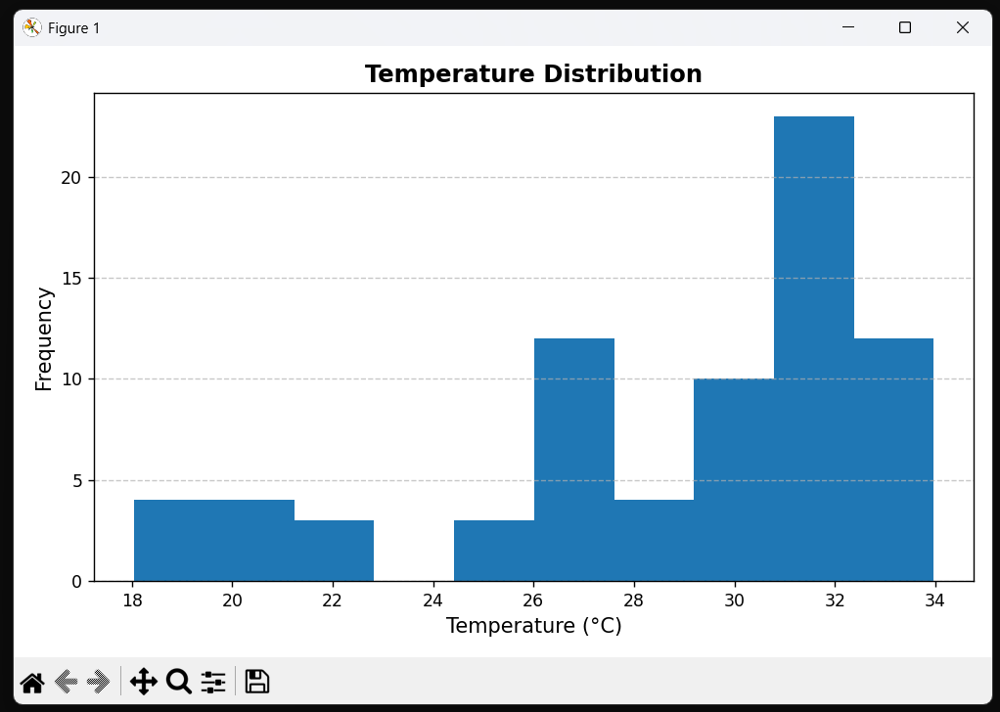

# 🌦️ Weather Data Pipeline & Analytics System

## 🚀 Overview

This project is a complete **End-to-End Data Engineering Pipeline** that extracts real-time weather data, processes it, stores it in a structured database, and generates meaningful insights through analytics and visualization.

It demonstrates core concepts of **ETL pipelines, data validation, database management, and data visualization**.

---

## 🧠 Key Features

* 🔄 **ETL Pipeline (Extract, Transform, Load)**
* 🗄️ **SQLite Database Integration**
* 📊 **Data Visualization (Bar Chart & Histogram)**
* ⚠️ **Automated Temperature Alerts**
* 🔥 **Hottest City Detection**
* 🏠 **House Price Analysis (CSV-based analytics)**

---

## ⚙️ Tech Stack

* **Python**
* **Pandas**
* **Matplotlib**
* **SQLite**

---

## 🔄 Pipeline Architecture

### 1️⃣ Extract

* Fetches weather data for multiple cities via API

### 2️⃣ Transform

* Validates and cleans raw data
* Filters out invalid or incomplete records

### 3️⃣ Load

* Stores processed data into SQLite database

---

## 📊 Visualizations

### 📌 Average Temperature Per Day


### 📌 Temperature Distribution



---

## 📁 Project Structure

```
weather_pipeline/
│
├── src/
│   ├── api_client.py
│   ├── database.py
│   ├── etl_pipeline.py
│   ├── reporter.py
│   ├── visualizer.py
│   ├── house_analysis.py
│   ├── validators.py
│
├── config/
├── data/
├── images/
│   ├── bar_chart.png
│   ├── histogram.png
│
├── main.py
├── README.md
```

---

## ▶️ How to Run

```bash
python -m main
```

---

## 📈 Output

* 📊 Weather reports in terminal
* ⚠️ Alerts for high temperature
* 🔥 Hottest city detection
* 📉 Graphical insights
 
 ### 📌 Output (Terminal)
.png)

.png)
---

## 🚀 Future Enhancements

* 🌐 Deploy using Streamlit dashboard
* ☁️ Integrate cloud database (AWS / Firebase)
* 📡 Real-time data streaming
* 📊 Advanced analytics & forecasting

---

## 👨‍💻 Author

**Sadaf**

---

## ⭐ Project Highlights

This project showcases:

* Real-world data pipeline implementation
* Clean modular code structure
* Practical data analysis and visualization

